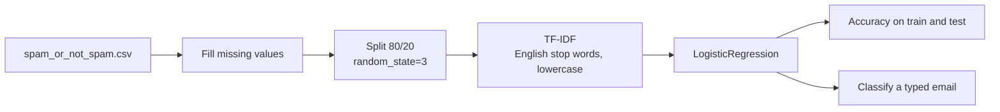

# Mailsieve

Spam versus ham email classification using TF-IDF features and logistic regression.

 

## Problem

Classify an email's text as spam or ham (legitimate). This is a binary text-classification task.

## Dataset

`data/spam_or_not_spam.csv`: 3,000 emails with columns `email` and `label`.

| label | meaning | count |
|---|---|---|
| 0 | ham | 2,500 |
| 1 | spam | 500 |

The text is already normalised (for example numbers appear as `NUMBER` and links as `URL`). Source and license of the data are not documented.

## Method



- **Vectoriser:** `TfidfVectorizer(min_df=1, stop_words='english', lowercase=True)`, fitted on the training split only.
- **Model:** `LogisticRegression()` with default parameters.
- **Split:** 2,400 training and 600 test emails.

## Results

From the saved notebook output:

| Split | Accuracy |
|---|---|
| Train | 96.92% |
| Test (600 emails) | 94.83% |

For context, predicting "ham" for every email would be correct for 2,500 of the 3,000 emails (83.3%). Accuracy alone is therefore not a sufficient measure here.

## How to run

```bash
git clone https://github.com/Praneetha1844/CodeAlpha_spam_email_classifier.git
cd CodeAlpha_spam_email_classifier
python -m venv .venv && source .venv/bin/activate   # Windows: .venv\Scripts\activate
pip install -r requirements.txt jupyter
jupyter notebook notebooks/mailsieve_tfidf_logreg.ipynb
```

The notebook reads `../data/spam_or_not_spam.csv`, relative to the `notebooks/` folder. The last cell asks for an email text with `input()` and prints `Spam mail` for label 1 and `Ham mail` for label 0.

## Repository structure

```
.
├── notebooks/mailsieve_tfidf_logreg.ipynb   # data prep, training, evaluation, prediction
├── data/spam_or_not_spam.csv                # labelled emails (0 = ham, 1 = spam)
├── requirements.txt
├── .github/workflows/ci.yml                 # validates notebooks, resolves dependencies
└── LICENSE
```

## Limitations and notes

- The classes are imbalanced (83% ham). Only accuracy is reported. Precision, recall, F1 and a confusion matrix are not computed.
- The split is random and not stratified, and there is no cross-validation or hyperparameter search.
- The notebook was changed to print `Spam mail` for label 1. It previously printed the opposite, and the saved output of that final cell was cleared because it came from the old mapping.
- The dataset is small and its origin is not documented, so results may not transfer to real mail. The model has not been tested on other datasets.
- 127 of the 3,000 rows are exact duplicates of another row (2,873 unique emails), so some test emails may also appear in the training split.

## Future work

- Report precision, recall, F1 and a confusion matrix, with stratified splits and cross-validation.
- Compare Naive Bayes, linear SVM and gradient boosting.
- Deduplicate the data and document its source.
- Package preprocessing and the model as a small, tested module.

## License

MIT. See [LICENSE](LICENSE).
